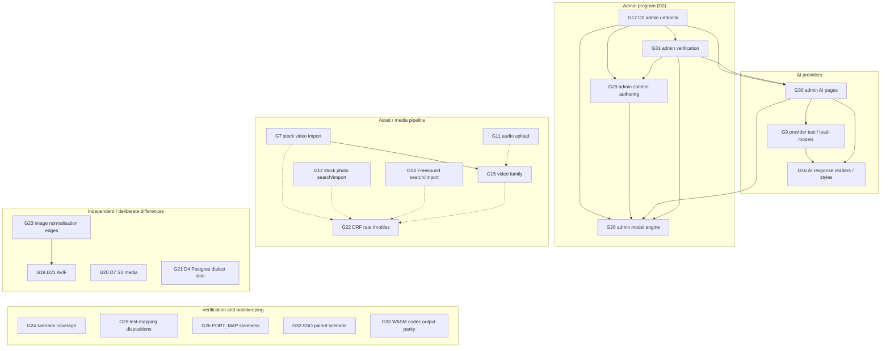

# GAPS — open work between the port and upstream

Single tracker for **what is not done yet**. Three other documents keep the
detail, and this file is the index that must stay in sync with them:

| document | what it answers |
|---|---|
| `docs/parity/GAPS.md` (this file) | Which behaviours are still missing/partial, why, and what closes each one |
| `docs/parity/PORT_MAP.md` | Per-upstream-file status (ported / partial / not started) — the file-level view |
| `docs/parity/DIVERGENCES.md` | Deliberate differences from upstream (D1–D22), each with a remove-when |
| `AGENTS.md` coverage table | Which PORT_MAP rows a parity scenario actually covers (proof, not status) |

Rules:

- **One row per gap**, stable id (`G<n>`), never reused.
- Every *registered but not ported* route or branch in the Go code
  (`route registered but not ported: …`) MUST have a row here: the
  `pnpm gaps-check` gate fails when a route from the pinned routes ledger is
  neither registered by the port nor listed below.
- When a gap closes, move the row to "Closed" with the commit, and update the
  corresponding PORT_MAP row in the same change.
- `Last verified` names the pin the route-level table was checked against.

Last verified: pin `2fb4d0297ec4c6e417b5225215502f8217c2a4dc` (doory@v0.2.0).

## Dependency graph (open gaps)

`A --> B` means **A depends on B**: B must land (or at least be understood)
before A can be completed faithfully. Dotted arrows are shared infrastructure
or parity-completeness dependencies, not necessarily hard blockers. The graph
is laid out top-to-bottom; the table below is the quick lookup form.

### Dependency lookup table

Read `Depends on` as "must land first". `soft` means shared infrastructure or
parity-completeness, not a hard feature blocker.

| gap | depends on | kind | note |
|---|---|---|---|
| G7 | G15 | hard | G15 provides the video probe/convert/store pipeline |
| G7 | G22 | soft | needs the video upload rate charge |
| G9 | G16 | hard | response readers/style pipeline |
| G11 | G15 | soft | shares the ffmpeg harness |
| G12 | G22 | soft | needs the stock rate charge |
| G13 | G22 | soft | needs the stock rate charge |
| G15 | G22 | soft | needs the video upload rate charge |
| G16 | — | — | AI response readers/style encoders |
| G17 | G28, G29, G30, G31 | hard | admin program umbrella |
| G19 | — | — | AVIF encoder missing |
| G20 | — | — | S3 storage seam |
| G21 | — | — | Postgres dialect runner lane |
| G22 | — | — | cross-cutting DRF throttle slice |
| G23 | G19 | hard | EXIF/normalisation parity still needs the AVIF path |
| G24 | — | — | verification of all families |
| G25 | — | — | test-mapping bookkeeping |
| G26 | — | — | PORT_MAP review bookkeeping |
| G28 | — | — | model engine (admin kernel is closed) |
| G29 | G28 | hard | content authoring builds on the engine |
| G30 | G9, G16, G28 | hard | AI pages build on AI transport and admin engine |
| G31 | G28, G29, G30 | hard | admin verification covers the whole program |
| G32 | — | — | verification of the closed SSO work |
| G33 | — | — | verification of the WASM codec output |

Notes:

- G11 shares the ffmpeg harness with G15, but does not require video import itself.
- G22 is a cross-cutting throttle slice: G7/G12/G13/G15 need their rate charges
  for full parity, but their core pipelines can be built first.

## A. Routes upstream has and the port does not register

| id | route | upstream behaviour | why it is open / what closes it |
|---|---|---|---|

Documented additions (not gaps): `/mcp`, `/mcp/health`, `/sitemap.xml`,
`/ws/designs/{uuid}/` come from D1/D7/D8 (single process, embedded SPA,
sitemap view).

## B. Registered routes with unported branches (loud `notPorted` errors)

These answer the ported validation/lookups, then a clear 500 saying exactly
which upstream function is missing — never a silent wrong answer.

| id | route | branch | what closes it |
|---|---|---|---|
| G7 | `POST /api/v1/stock/videos/import/` (and the live branch of `GET /stock/videos/`) | `video_stock.import_video`: resolve via the provider API, download with host checks, probe, convert, insert the asset | Video family (G15). The no-config payloads and serializer bounds are ported. |
| G9 | `POST /api/v1/ai/providers/{id}/test/`, `/load-models/` | `services.test_provider` (sample picture call, preview, AICall log), `catalog.list_remote_models` | Same provider transport as the AI family's run path, plus the sample image and the remote catalogue mapping. Row lookups are ported. |
| G11 | `POST /api/v1/assets/` with an audio upload | `assets._prepare_audio` (`assets/audio.py`: container/codec probe, duration, waveform) | Audio pipeline. Note the audio *library* install (`sync_audio`) is ported; only uploads are not. |

## C. Live-network paths that only work in their no-config shape

| id | area | today | what closes it |
|---|---|---|---|
| G12 | Stock photos: Unsplash / Pexels / Pixabay search + import | Validation + `_not_configured` payloads match the oracle; no provider call | Provider HTTP clients with the fake-provider fixtures (`assets/providers.py`, `remote.py`, counting/pausing/redaction). |
| G13 | Freesound: search, info, import, preview | Same (no-config shapes + messages) | `assets/freesound.py` client + preview streaming. |
| G15 | Video family | Availability + limits + no-config payloads only | `assets/video.py` (ffprobe/ffmpeg probe + conversion), `video_jobs.py` (queue, 202 processing, poster/filmstrip/audio), `ingest_video_upload`, `sweep_video_jobs`, live stock-video providers, and video export in `exports/`. |
| G16 | AI provider response readers / style encoders (`ai/styles/{base,multipart,json_b64,mask,custom}.py`, `results.py`) | The port builds the doory multipart request and maps errors; response decoding and style variants are partial | Port the styles + result readers; needs the fake-provider harness to prove wire behaviour. |

## D. Deliberate differences that are still open work

| id | divergence | status |
|---|---|---|
| G17 | **D2 — Django admin** | Owner approved the Go admin on 2026-10-26: full route-shape coverage, server-rendered (no-Unfold) HTML, staff read + superuser writes until per-model permissions land. G27 is closed; the remaining work is split into G28–G31. |
| G19 | **D21 — AVIF** | Not made at all (no pure-Go encoder); `/config/` advertises `png,jpg,webp` and the endpoint rejects `avif`. Closes with an AVIF encoder. |
| G20 | **D7 — S3 media storage** | Local media only; the `storages` seam is not ported. |
| G21 | **D4 — Postgres dialect lane** | Schema digest + `pg-smoke` run on Postgres; the runner does **not** replay each scenario on Postgres. Wiring the dialect matrix into `test/parity` closes it. |
| G22 | **D6/D11-family leftovers** | Scoped DRF rate throttles are not enforced end-to-end (the account lockout is); `REST_FRAMEWORK` rates still need the kernel throttle slice. |
| G23 | Image normalisation edges | EXIF orientation/normalisation and AVIF decode paths differ from Pillow's; loud or structural today, not byte-equal. The WebP/JPEG encoder half is closed by G18. |

## E. Verification and bookkeeping deficits

| id | item | state |
|---|---|---|
| G24 | Scenario coverage | 109 of 338 PORT_MAP rows are covered by ≥1 scenario (85 reviewed-but-uncovered). Weakest: `mcp` 0/21, `ops` 10/34, `elements` 3/24 — see the AGENTS.md table (`pnpm coverage`). |
| G25 | `ledger/test-mapping` dispositions | Pending/partial entries remain for mcp, ops, elements, gallery, design-doc and the 0.2.0 files (video, optimizers, OIDC, my-sizes). Each needs evidence or a named missing case. |
| G26 | PORT_MAP staleness | Some cells lag the code (e.g. `exports/optimizers/builtin.py` is implemented in process per D22 but still says "shrink pending"). Rule: whoever touches an upstream file updates its row in the same commit. |
| G32 | SSO paired-scenario coverage | OIDC and Google sign-in now have Go integration tests (`doory/oidc_sso_test.go`), but no paired oracle scenario yet. Wiring one needs a fake provider (discovery/JWKS/token/userinfo) and a trusted TLS endpoint the Django oracle can reach; until then the SSO rows are review/test-covered, not scenario-covered. |
| G33 | WASM codec output parity | The built-in optimizer now runs official cjpeg 4.1.5 / oxipng 10.2.1 WASI CLIs as child processes, but no fixture compares their optimized bytes with the native oracle tools. Add native-vs-WASI output fixtures (and decide whether `WITH_SIMD=0` is acceptable) before claiming byte parity. |

## F. Admin program (D2 — owner-approved 2026-10-26)

| id | slice | what closes it |
|---|---|---|
| G28 | Admin model engine and moderation | Descriptor-driven changelist/add/change/delete/history/actions engine; User + auth.Group, ApiToken, Asset, BrandKit, Design/DesignVersion/Folder, ShareLink, Comment; upstream action semantics (mark-verified/activate/deactivate never self, revoke, trash/restore, link toggle, comment delete) and the delete-file cleanup those paths need. |
| G29 | Admin content authoring | TemplateCategory/Template (JSON document + thumbnail + validate/duplicate/feature), ElementPack/Element (SVG + bulk upload + publish), FontFamily/FontVariant inline upload, SizePresetGroup/SizePreset (tags/aliases/meta + activate clash check); post_delete cleanup for template thumbnails, element SVGs, pack thumbnails and font files. |
| G30 | Admin AI pages | Operator Provider CRUD (secret keep/clear/host-change drop, tasks/style validation, allowed users, provider-model inline), env-provider panel, UserProvider/AICall read-only; `load-models`/`test` confirm + result pages. The transport-dependent half waits on G9; until then those two actions answer a tracked not-ported page. |
| G31 | Admin verification and bookkeeping | Port the 73 upstream `test_admin.py` behaviours to Go integration tests; scenario `22-admin` covers all 11 `admin.py` rows + 4 admin templates with shared wire/state assertions; admin CRUD smoke in `test/pgsmoke`; PORT_MAP/test-mapping/coverage updates; self-hosting docs; D2 evidence (markup stays a recorded difference). |

## Closed (with the commit that closed it)

| id | gap | closed by |
|---|---|---|
| — | 0.2.0 routes the rebuilt frontend called: `size-presets/mine`, `auth/oidc/{start,callback,connection}` (no-provider surface), `stock/videos{,/providers,/import}`, `designs/{id}/{fields,thumbnail}`, `designs/bulk`, `exports/optimize`, `auth/password/reset{,/confirm}`, `auth/email/{verify,resend}` | `2892176`, `dc77682` |
| — | Starter content + fonts embedded and installed by `entrypoint` (D19); in-process built-in optimizer (D22) | `dc77682` |
| G1 | `POST /api/v1/designs/{id}/fill/` — fill template fields as a copy or in place | `d98f9a4` |
| G10 | SVG asset upload (sanitise, size cap, intrinsic sizing, stored markup) | `486fec3` |
| G14 | Remote image fetch (`URL_IMAGE_UPLOADS`, bulk-fill/fill URL values, stock import downloads) | `c22b721` |
| G18 | WebP/JPEG encoding through embedded libwebp 1.6.0 + libjpeg-turbo 3.1.0 (Pillow byte parity) | `fcb66a5` |
| G27 | Admin kernel and CLI (staff/session/CSRF, index/app/search/autocomplete/jsi18n, never_cache/Vary, admin log/history, bootstrap commands, auth seed) | `c4f61f7` |
| G2 | `POST /api/v1/designs/{id}/bulk-fill/` — one copy per row, row errors, name pattern/folder/export | `5ca20e3` |
| G4 | `GET /api/v1/schema/`, `GET /api/v1/docs/` — pinned OpenAPI document + staff Swagger UI | `a02fad8` |
| G5 | `POST /api/v1/templates/{slug}/use/` — create a design from a published template | `48e87a0` |
| G8 | `POST /api/v1/exports/optimize/` with TinyPNG/Kraken/custom | `681f4e3` |
| G3 | `POST /api/v1/auth/google/` — Google ID-token verification and link/create | `d02759a` |
| G6 | OIDC provider flows (start/callback/connect, discovery, PKCE, JWKS, ID-token verification) | `d02759a` |
| — | Clone-build without parity tooling; `:8111` default; `scripts/install-systemd.sh` (`~/.doory`) | `5a22cd7` |
